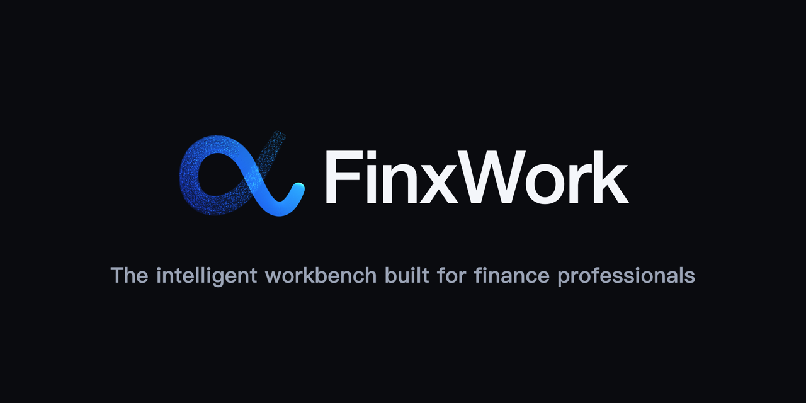

<div align="center">



<br /><br />

<picture>
  <source media="(prefers-color-scheme: dark)" srcset="assets/brand/motion/finxwork-mark-flow-dark.gif" />
  
</picture>

<br />

<picture>
  <source media="(prefers-color-scheme: dark)" srcset="assets/brand/lockup/finxwork-lockup-horizontal-dark.png" />
  
</picture>

<p>
  <strong>The intelligent workbench built for finance professionals</strong>
</p>

<p>
  <a href="README.md">简体中文</a> · <strong>English</strong>
</p>

<p>
  <a href="https://github.com/finxwork/finxwork/stargazers"></a>
  <a href="https://github.com/finxwork/finxwork/network/members"></a>
  <a href="https://github.com/finxwork/finxwork/issues"></a>
  
  
  
  
</p>

<p>
  <a href="#byok--existing-subscription-connections">BYOK & Subscriptions</a> ·
  <a href="#key-capabilities">Key Capabilities</a> ·
  <a href="#quick-start">Quick Start</a> ·
  <a href="#architecture">Architecture</a> ·
  <a href="#star-history--citation">Star History & Citation</a>
</p>

</div>

---

## BYOK & Existing Subscription Connections

**FinxWork never locks you into a single vendor or forces extra API spend.** Alongside standard Bring-Your-Own-Key (BYOK) and cloud Token Plans, you can directly connect the AI subscriptions you already pay for—including **ChatGPT**, **QwenWork (千问办公)**, and **Qoder**—right inside one unified workbench:

| Connection Mode | Supported Providers & Capabilities |
| --- | --- |
| **Existing Subscriptions (Zero Extra API Cost)** | <ul><li><strong>ChatGPT</strong>: Browser OAuth sign-in that uses your active ChatGPT subscription quota directly—no separate API key required</li><li><strong>QwenWork (千问办公)</strong>: Discovers and connects to your signed-in local QwenWork desktop account, establishing an independent model session</li><li><strong>Qoder</strong>: Connects directly to your local Qoder account to bring its models and quota into FinxWork workflows</li></ul> |
| **Token Plan & Coding Plan Bundles** | Native support for **Alibaba Cloud Bailian Token Plan**, **Tencent Cloud Token Plan**, **Volcengine Ark Agent Plan / Coding Plan**, and **Zhipu GLM Coding Plan (China / Z.ai International)** with refreshable plan catalogs |
| **Standard BYOK (Bring Your Own Key)** | Built-in adapters for **OpenAI, Anthropic, Google, DeepSeek, Qwen, Moonshot (Kimi), MiniMax, Zhipu AI, xAI, and OpenRouter** with pre-configured context windows, reasoning options, and pricing metadata |
| **Enterprise Gateways & Local Models** | Connect any **OpenAI- or Anthropic-compatible custom endpoint**—company relays, private gateways, or local inference servers like **Ollama**—with automatic protocol detection for strict financial data governance |

> All keys and credentials remain stored locally on your machine. Switch default models and reasoning levels directly from the workbench UI or via `finx login`.

---

## Key Capabilities

Designed around high-frequency financial workflows—investment research, financial modeling, report drafting, and roadshow presentations—**FinxWork** unifies a Rust agent kernel and a desktop workbench so analysts and AI operate on the exact same live files and workspace:

<table>
  <tr>
    <td width="50%" valign="top">
      <h3>📊 Financial Modeling & Spreadsheet Recalculation</h3>
      <p>Native editing for <code>.xlsx</code>, <code>.csv</code>, and <code>.tsv</code> plus read-only <code>.xls</code> parsing. The built-in calculation engine supports structured reference expansion, full recalculation, circular reference inspection, and impact analysis without altering original formula text—every change is tracked and reversible.</p>
    </td>
    <td width="50%" valign="top">
      <h3>📄 Research Reports & PDF Inspection</h3>
      <p>Read filings, prospectuses, and <code>.docx</code> reports side-by-side with the conversation, select text or PDF regions directly as citations, and edit Word documents with surgical saving and faithful PDF export that preserves original layout, headers, and tables.</p>
    </td>
  </tr>
  <tr>
    <td width="50%" valign="top">
      <h3>📽️ Pitch Decks & Presentation Editing</h3>
      <p>High-fidelity <code>.pptx</code> slide rendering and targeted content updates that preserve existing slide masters, charts, and typography for fast, compliant deck revisions.</p>
    </td>
    <td width="50%" valign="top">
      <h3>🌐 Browser Co-browsing & Verification</h3>
      <p>Companion Chrome extension and native browser bridge (<code>finx-browser</code>) let agents query live filings and web sources while reusing your authenticated browser sessions, with built-in preview and citation verification.</p>
    </td>
  </tr>
  <tr>
    <td width="50%" valign="top">
      <h3>🤖 Dedicated Bots, Subagents & Skills</h3>
      <p>Configure specialized Bots and scheduled Routines for recurring research workflows, orchestrate parallel subagents for deep analysis, and connect proprietary data sources through MCP (Model Context Protocol) and custom Skills.</p>
    </td>
    <td width="50%" valign="top">
      <h3>🔒 Local-First & Explicit Approvals</h3>
      <p>Zero telemetry across the entire stack. Document edits land in working copies first before saving back to disk, and sensitive system actions require explicit permission approval to safeguard financial data and workspaces.</p>
    </td>
  </tr>
</table>

---

## Quick Start

### Run the Workbench from Source

```bash
# 1. Build the Rust agent kernel and document engines (requires Rust 1.89+)
cargo build

# 2. Install frontend dependencies and launch the desktop workbench (requires Node.js + pnpm)
pnpm install
pnpm dev
```

### CLI & Automation

Beyond the desktop workbench, FinxWork also runs directly in the terminal or automated pipelines via the `finx` CLI:

```bash
# Connect a model provider (ChatGPT subscription, Token Plan, BYOK, or local endpoint)
finx login

# Start an interactive terminal session
finx

# Run a single task with structured JSON output
finx exec --json "Review the financial model in this directory and summarize key metric changes"
```

Integrate with editors and external tools over `finx acp` (Agent Client Protocol) or `finx serve` (JSON-RPC). See [docs/cli/quickstart.md](docs/cli/quickstart.md) and [docs/cli/llms.txt](docs/cli/llms.txt) for details.

---

## Architecture

```text
finxwork/
├── apps/
│   ├── desktop/              # Electron + React 19 desktop workbench (@finx/desktop)
│   └── chrome-extension/     # Browser companion extension
├── crates/
│   ├── finx-core/            # Agent kernel, session loop, subagents, prompts
│   ├── finx-cli/             # CLI entry point (finx / exec / acp / serve)
│   ├── finx-docs/            # Unified working copies, revision history, PDFium backend
│   ├── finx-sheet/           # Spreadsheet recalculation, circular refs, CSV/XLS/XLSX
│   ├── finx-word/            # Word (.docx) collaborative editing & layout engine
│   ├── finx-slide/           # PowerPoint (.pptx) rendering & surgical editing
│   ├── finx-browser/         # Browser automation & native-host bridge
│   ├── finx-llm/             # Model providers, catalogs, credentials
│   ├── finx-mcp/             # Model Context Protocol (MCP) integration
│   ├── finx-tools/           # Workspace, terminal, and web search tools
│   ├── finx-connections/     # ChatGPT, QwenWork, and Qoder subscription adapters
│   ├── finx-acp/             # ACP server
│   ├── finx-rpc/             # JSON-RPC transport
│   ├── finx-server/          # Local backend server
│   └── finx-protocol/        # Shared Rust / TypeScript protocol schema
├── packages/
│   ├── client/               # TypeScript client SDK
│   └── protocol/             # Generated TypeScript protocol types
└── assets/brand/             # Brand mark, lockups, and motion assets
```

---

## Star History & Citation

<div align="center">

<a href="https://star-history.com/#finxwork/finxwork&Date">
  <picture>
    <source media="(prefers-color-scheme: dark)" srcset="https://api.star-history.com/svg?repos=finxwork/finxwork&type=Date&theme=dark" />
    <source media="(prefers-color-scheme: light)" srcset="https://api.star-history.com/svg?repos=finxwork/finxwork&type=Date" />
    
  </picture>
</a>

</div>

If **FinxWork** supports your research, financial workflows, or engineering benchmarks, feel free to cite it:

```bibtex
@software{finxwork2026,
  title  = {FinxWork: The Intelligent Workbench Built for Finance Professionals},
  author = {FinxWork Contributors},
  year   = {2026},
  url    = {https://github.com/finxwork/finxwork}
}
```
