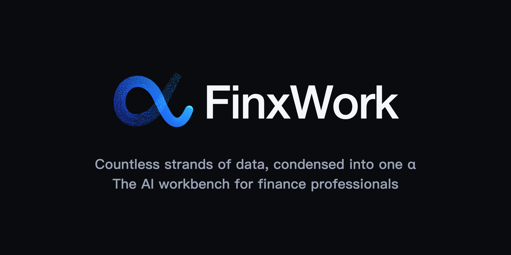

<div align="center">



<br /><br />

<picture>
  <source media="(prefers-color-scheme: dark)" srcset="assets/brand/motion/finxwork-mark-flow-dark.gif" />
  
</picture>

<br />

<picture>
  <source media="(prefers-color-scheme: dark)" srcset="assets/brand/lockup/finxwork-lockup-horizontal-dark.png" />
  
</picture>

<p>
  <strong>Countless strands of data, condensed into one α.</strong><br />
  An AI agent kernel, CLI, and desktop workbench for code, terminals, spreadsheets, documents, slides, and the browser.
</p>

<p>
  <strong>English</strong> · <a href="README.zh-CN.md">简体中文</a>
</p>

<p>
  <a href="https://github.com/finxwork/finxwork/stargazers"></a>
  <a href="https://github.com/finxwork/finxwork/network/members"></a>
  <a href="https://github.com/finxwork/finxwork/issues"></a>
  
  
  
  
</p>

<p>
  <a href="#quick-start">Quick Start</a> ·
  <a href="#three-ways-in">Three Ways In</a> ·
  <a href="#architecture">Architecture</a> ·
  <a href="#documentation">Documentation</a> ·
  <a href="#citation">Citation</a>
</p>

</div>

---

## Overview

**FinxWork** combines a high-performance Rust agent kernel (`finx`) with an Electron + React 19 desktop workbench (`@finx/desktop`) and browser companion (`apps/chrome-extension`). It reads and edits code, runs terminal commands, searches the web, automates browser workflows, and natively opens, computes, and edits spreadsheets, Word documents, slides, and PDFs—using the model provider you choose.

| Capability | Highlights |
| --- | --- |
| **Agent Kernel & CLI (`finx`)** | Interactive terminal sessions, one-shot `finx exec --json` scripting, subagents, MCP servers, and zero telemetry |
| **Office & Document Native Engine** | Built-in support for `.xlsx`/`.csv`/`.tsv` recalculation, `.docx`, `.pptx`, and PDF inspection via `finx-docs` / `finx-sheet` / `finx-word` / `finx-slide` |
| **Desktop Workbench (`@finx/desktop`)** | Rich visual editor, Markdown/KaTeX/Mermaid rendering, model connections, and side-by-side document workspace |
| **Browser Automation** | Companion Chrome extension + `finx-browser` native host for live web inspection and workflows |
| **Open Protocols** | Agent Client Protocol (`finx acp`) for editors and JSON-RPC (`finx serve`) for programmatic integrations |
| **Model Flexibility** | API keys, Token Plans, ChatGPT subscription, local Ollama, or custom OpenAI-compatible endpoints |

---

## Quick Start

### Install CLI

```bash
curl -fsSL https://github.com/finxwork/finx-releases/releases/latest/download/install.sh | sh
```

Supports **macOS** and **Linux** (`x86_64` and `arm64`), installing the `finx` binary to `~/.local/bin`. See [docs/cli/quickstart.md](docs/cli/quickstart.md) for alternative installation methods.

### Thirty Seconds to Run

```bash
finx login
finx "explain what this repository does"
```

`finx login` connects a model: an API key, a Token Plan, a ChatGPT subscription, a local Ollama instance, or a compatible custom service. Nothing is assumed—until you configure a provider, `finx` tells you explicitly.

### Build from Source

```bash
# 1. Build the Rust workspace (requires Rust 1.89+, edition 2024)
cargo build

# 2. Run the Desktop app (requires Node.js + pnpm)
pnpm install
pnpm dev
```

---

## Three Ways In

- **In the terminal.** `finx` starts an interactive conversation that stays in your terminal's own scrollback and asks before changing anything until you tell it otherwise.
- **In scripts.** Run one task and get structured output:

  ```bash
  finx exec --json "summarize the changes on this branch" | jq -r .final_output
  ```

  Exit codes report the exact outcome: `0` done, `1` failed, `2` bad usage or no model, `3` completed with an action refused for lack of approval, `130` interrupted. See [docs/cli/scripting.md](docs/cli/scripting.md).

- **From other programs.** `finx acp` serves editors over the Agent Client Protocol ([acp.md](docs/cli/acp.md)). `finx serve` speaks JSON-RPC ([json-rpc.md](docs/cli/json-rpc.md)); [examples/rpc](examples/rpc) provides a complete client in a single page of Python.

---

## Security & Privacy

- **Permission boundaries instead of hidden assumptions.** There is no OS-level sandbox; protection is enforced via permission modes, rules, workspace boundaries, and protected paths ([permissions.md](docs/cli/permissions.md)). Use `bypass-permissions` only inside a container or disposable environment.
- **Repository prompt awareness.** `AGENTS.md` and project-level Skills are always read when entering a workspace.
- **Zero telemetry.** Every network call is documented in [privacy.md](docs/cli/privacy.md).

<details>
<summary><strong>For Coding Agents</strong> — automation flags, JSON contracts, and environment rules</summary>

If you are a coding agent setting `finx` up or invoking it:

- Run a task with `finx exec --json "TASK"`. The answer is in `final_output`; `exit_code`, `error`, `tool_calls`, and `refused` describe the run. `finx exec --resume last "NEXT"` continues the previous session.
- `finx status --json`, `finx doctor --json`, `finx models --json`, and `finx tools --json` inspect the environment without mutating state.
- Failures under `--json` emit JSON to stdout: `{"error": {"kind", "message", "help"}, "exit_code": 2}`.
- Exit code `3` indicates an action was refused because no interactive approval was available—configure a permission mode or rule rather than retrying blindly.
- Pass `--dangerously-skip-permissions` only when explicitly instructed by the user or inside an isolated container for that run.
- Pass API keys via stdin, never as CLI arguments: `printf %s "$KEY" | finx login deepseek --key-stdin --model deepseek/deepseek-flash`.
- `finx config set` refuses permission changes while `AI_AGENT` is set; permission settings belong to the human operator.
- Full LLM-friendly documentation index: [docs/cli/llms.txt](docs/cli/llms.txt).

</details>

---

## Architecture

```text
finxwork/
├── apps/
│   ├── desktop/              # Electron + React 19 workbench (@finx/desktop)
│   └── chrome-extension/     # Browser companion extension
├── crates/
│   ├── finx-core/            # Agent kernel, session loop, subagents, prompts
│   ├── finx-cli/             # CLI binary (`finx`, `exec`, `acp`, `serve`)
│   ├── finx-llm/             # Model providers, catalogs, credentials
│   ├── finx-tools/           # Built-in workspace, shell, and web tools
│   ├── finx-docs/            # Unified document store & indexing
│   ├── finx-sheet/           # Spreadsheet formulas, recalculation, CSV/XLS/XLSX
│   ├── finx-word/            # Word (.docx) editing & layout support
│   ├── finx-slide/           # PowerPoint (.pptx) rendering & surgical editing
│   ├── finx-browser/         # Browser automation & native-host bridge
│   ├── finx-mcp/             # Model Context Protocol (MCP) integration
│   ├── finx-acp/             # Agent Client Protocol server
│   ├── finx-rpc/             # JSON-RPC transport
│   ├── finx-server/          # Local backend server
│   ├── finx-protocol/        # Shared Rust/TS protocol schema
│   └── finx-connections/     # Provider & Token Plan connections
├── packages/
│   ├── client/               # TypeScript client SDK
│   └── protocol/             # Generated TypeScript protocol types
└── assets/brand/             # Brand mark, lockups, and motion assets
```

---

## Documentation

[Quickstart](docs/cli/quickstart.md) · [Models](docs/cli/models.md) · [Tools](docs/cli/tools.md) · [Permissions](docs/cli/permissions.md) · [Scripting](docs/cli/scripting.md) · [ACP](docs/cli/acp.md) · [JSON-RPC](docs/cli/json-rpc.md) · [Privacy](docs/cli/privacy.md) · [Troubleshooting](docs/cli/troubleshooting.md) · [LLM Index](docs/cli/llms.txt)

---

## Star History

<div align="center">

<a href="https://star-history.com/#finxwork/finxwork&Date">
  <picture>
    <source media="(prefers-color-scheme: dark)" srcset="https://api.star-history.com/svg?repos=finxwork/finxwork&type=Date&theme=dark" />
    <source media="(prefers-color-scheme: light)" srcset="https://api.star-history.com/svg?repos=finxwork/finxwork&type=Date" />
    
  </picture>
</a>

</div>

---

## Citation

If you use **FinxWork** in your research, workflow, or engineering benchmarks, feel free to cite it:

```bibtex
@software{finxwork2026,
  title  = {FinxWork: The AI Agent Kernel and Workbench for Finance and Engineering},
  author = {FinxWork Contributors},
  year   = {2026},
  url    = {https://github.com/finxwork/finxwork}
}
```
