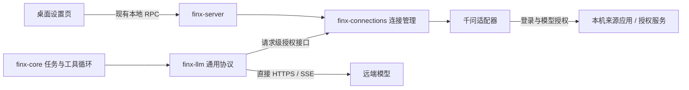

# 内核内模型连接：架构与接口

日期：2026-10-29。状态：已实现，替代早先的独立 Node 网关方案。

后续扩展方案见 [Qoder 模型连接机制设计](qoder-connection-design.md)，Qoder 首版的多适配器与请求级传输已实现，等待事件和 legacy 仍属后续设计。

ChatGPT 订阅直连的实现、测试和真实账户联调见 [ChatGPT API 订阅连接](chatgpt-api-design.md)。

## 决策

模型连接能力运行在已有 `finx` 服务进程中。产品协议以独立 Rust crate 隔离，桌面不运行第二个模型网关，不安装 Node 运行时或 LaunchAgent。推理直接从现有模型调用层请求远端。

## 模块职责与依赖

| 模块 | 负责 | 不负责 |
|---|---|---|
| 桌面 Renderer | 扫描、连接、重试、断开、删除、状态展示；使用现有 RPC | 读凭据、签发模型 token、转发推理 |
| Electron 主进程 | 原有内核监管、打开来源应用；一次性退役旧网关 | 安装新网关、承载模型授权 |
| finx-server | 公开管理 RPC、模型变更通知、装配连接管理器 | 千问域名、凭据格式、换发策略 |
| finx-connections | 配置与身份绑定、并发租约、连接生命周期、产品适配器、钥匙串读写 | 任务提示词、工具执行、模型流解析 |
| finx-llm | 通用 ConnectionAuthorizer / ConnectionRequest 接口、协议序列化与 SSE 解析、HTTP 客户端、有限重试 | 千问特定字段与本机文件格式 |
| finx-core | 原有任务、上下文、工具与审批 | 产品适配器实现 |

`finx-connections` 依赖 `finx-llm` 的接口与 `finx-protocol` 的公共 DTO；`finx-llm` 不依赖 `finx-connections`。服务器装配二者，避免循环依赖。内核的 HTTP 客户端由模型层惰性创建，并在授权请求与推理之间复用。

同进程不提供进程级故障隔离。供应商适配器变更不修改任务内核代码，但仍需要重新构建和发布内核二进制。

## 生命周期与资源

- 初始化只读取非秘密配置和缓存目录；没有连接时不访问千问、钥匙串或网络，不创建轮询、续期任务、监听端口或辅助进程。
- 只有打开模型设置或手动扫描才执行安装检测；这可能短暂调用系统 `plutil`，不产生常驻网关。
- 连接时读取来源账号，发现目录，准备独立模型 session；私密 session 保存到独立的 Keychain 命名空间。
- provider ID 由来源应用和账号身份摘要生成：`local-<adapter_id>-<摘要前 12 位>`，与随机的 connection_id 无关。同一账号移除后重新连接，发布的 provider/model ID 不变，用过它的会话接着用原模型。此前写入的连接记录没有 provider ID，继续使用 `local-<connection_id>`。快照中的 `ConnectionView.provider_id` 给出它，桌面不自行拼接。
- 断开或移除连接后，用过它的会话仍能打开：恢复会话时找不到上次所用模型的服务商（`UnknownProvider`），就改用默认模型，并发出一条警告说明原模型暂不可用；没有默认模型时仍然打开，历史能看，警告说明要接入模型，发送时任务失败（standalone-cli-design §7.2）。会话日志不改写，连接恢复后再打开即回到原模型。明确指定了模型的恢复不做替换。
- 已启用连接在内核重启后从缓存恢复稳定 provider/model ID。恢复时的 ready 表示配置可用；授权有效性在实际请求前核实，不通过空闲刷 token 维持状态。
- 每次推理取得一个请求租约，核实来源身份，按需恢复/换发授权；请求结束或取消即释放租约。
- 断开先禁用新请求、持久化状态、从可选模型中移除连接，再等待当前请求结束。删除仅接受已禁用且无活跃请求的连接。
- 桌面退出后，原有 Rust 服务继续处理已提交任务。连接模块不改变内核已有的空闲退出策略。

连接不限制并发：同一连接上的多个请求（主会话与子智能体等）同时进行，和直连的模型服务商一样。租约只用于计数，断开时等全部请求结束。

## 授权边界

`finx-llm::connection` 定义：

- `ConnectionAuthorizer::begin(provider, model, http)`：验证连接与模型，取得请求租约。
- `ConnectionRequest::authorize(rejected)`：返回本次请求的一致 `base_url + Credentials`。
- `ConnectionRequest::cancellation()`：连接级取消信号。
- `ConnectionRequest::failed(error)`：更新连接状态；错误保留网关原话，但去掉可能代表账户的长串（token、session 与请求 ID），截到 500 字，并写入内核日志。千问网关的 429 表示一时的请求或 token 份额用完，用的却是 OpenAI 表示欠费的措辞：原话不提欠费、余额、充值时按限流处理，自动重试（2026-11-02 观察到：同一账户在同一时刻有的请求成功、有的报这个错）。

授权结果不实现 Debug 或 Serialize；动态请求头保存在 Credentials，Debug 不输出其值。账号 token、模型 token、session_id 不进入模型目录、桌面 RPC、历史任务模型元数据或普通日志。

产品适配器独立生成模型 session。来源应用登录文件只读，不刷新来源 refresh_token，不写回其账户与模型凭据文件。账号发生变化时取消当前连接并要求显式断开、移除、重新连接。

会话换发依据实际 TTL，采用请求触发、适配器互斥和失败退避。明确收到 401 且还未输出模型内容时，模型层允许一次重新授权和重发；第二次 401 直接失败。流已经输出内容后不重放请求。

远端地址与路径仍由产品适配器检查。客户端发布版本只用于展示、诊断和真实请求头，不作为连接准入条件；授权文件协议及实际接口响应仍需验证。HTTP 禁止自动跟随重定向，避免动态授权被带到未验证的目标。macOS 仍使用系统证书校验；没有关闭 TLS 验证。

## 管理协议

沿用 finx 原生协议版本 2，增加 `model_connections` 能力位。新桌面要求该能力位，旧内核由现有监管器在没有活跃任务时替换。

| RPC | 入参 | 返回 |
|---|---|---|
| connections/discover | 空对象 | `{ discoveries: ConnectionDiscovery[] }` |
| connections/list | 空对象 | `{ revision, connections: ConnectionView[] }` |
| connections/connect | adapter_id、discovery_id、idempotency_key | 完成后的连接快照 |
| connections/retry | connection_id | 重新核实身份、刷新目录与授权后的快照 |
| connections/models | connection_id | 与 retry 同样重新核实并刷新 |
| connections/disconnect | connection_id | 禁用并等待当前请求结束后的快照 |
| connections/remove | connection_id | 删除后的快照 |
| models/changed | 内核通知 | 客户端重新拉取模型与连接状态 |

管理操作异步执行，不阻塞 Rust 事件循环，但 RPC 本身在操作完成后回复；不再保留跨进程 operation_id 轮询。错误使用 JSON-RPC error，data.kind 提供稳定分类。连接配置在远端签发前落盘；idempotency_key 防止重复创建本地连接，不保证远端签发 exactly-once。

状态：connecting、ready、disabled、needs_login、permission_required、unsupported、unavailable。同进程同步目录，不再需要 kernel_sync、源租约、心跳、动态代理端口或本地访问密钥。

源码类型及生成 schema 是接口事实来源：`finx-protocol/src/api.rs`、`schema.json`、`packages/protocol/src/generated.ts`。

## 从旧网关迁移

桌面启动时只对当前 FINX_HOME 的旧 LaunchAgent 执行一次迁移：停止接收新请求、等待在途推理完成、bootout、确认退出，将 plist 移到 `connections/legacy/*.retired`。此后不会重新安装或启动它。

原有 `connections/config.json`、connection_id、账号绑定和本服务 Keychain 命名空间保留，Rust 适配器直接读取。旧运行时目录保留为迁移遗留文件，不再执行。迁移等待失败时不启动新的连接所有者，防止两个实现同时换发同一个 session。

## 验收和边界

当前适配范围为 macOS、QwenWorkCN 标准账户、文字、图片与工具调用。1.4.0 是已有实测版本，不限制其他发布版本；能否连接由登录信息、模型目录和独立授权的实际结果决定。千问办公的目录不标图片能力，其模型一律按可收图处理（flash 已实测）。连接的模型与其他渠道走同一次合并（model-catalog-design §4.7）：应用目录声明的字段优先，没声明的按模型 ID 查模型厂商在公共目录的行，都没有就保持未知。千问办公的目录不给输出上限，请求就不带上限，由网关决定。目录项的 `key` 是请求用的模型 ID，有的账户是 `mode-xxx` 这样不可读的串，界面不直接显示：名称按千问办公自己的顺序，先取 `i18n.display_name` 里的多语言名称（实测目录只有这一处有名称），再取 `displayName`、`display_name`、`name`，条目本身没有就看它的 `server_model`，都没有才退回 `key`。思考档位的判断同样看这些名称（2026-11-06）。内核不知道界面语言，所以多语言名称原样放进 `ConnectionModel.names`，经 `models/list` 的 `ModelSummary.names` 交给客户端：桌面端按界面语言选，先找完全相同的语言标签，再找基础语言（`zh-CN` → `zh`），没有这种语言就用 `name`。`name` 给没有语言可选的客户端（命令行、ACP），中文优先，其次英文，因为来源是国内版。切换语言不影响选中的模型，会话和请求始终用模型 ID。服务商名称同样处理：千问办公的中英文名由适配器给出，经 `ProviderSummary.names` 交给客户端，模型菜单的分组标题和其他显示服务商的地方都跟随界面语言。已有连接的名称随下一次目录刷新更新，最长 24 小时，重新验证连接会立刻更新。真实跨 TTL 的长时间连续换发与系统睡眠测试仍独立列为待验证项。

其他供应商新增表单仍是此前 Demo，未在本次重构中扩展为真实 BYOK 配置。原有内核 BYOK 通路继续使用。

## 连接诊断（2026-11-03）

千问及 Qoder 不再按客户端版本放行。千问请求头发送读取到的真实版本与 build；Qoder 不要求桌面版本请求头。来源产品、认证域、凭据协议和服务地址的边界仍保留，并分别报告原因。Qoder 目录只需包含一个已适配模型，不强制要求 Auto。

`ConnectionDiagnostic` 贯穿 RPC 的 `data.diagnostic`、`ConnectionView.diagnostic` 与发现失败时的 `ConnectionDiscovery.diagnostic`。旧 `data.kind`、`reason_code` 保留兼容。诊断包括 stage、code、message、retryable、action、checked_at，以及可选 http_status、field。字段名与消息由本地代码生成，不发送完整响应、令牌、登录文件、用户身份或解密数据。诊断保存在运行中内核的连接快照；关闭并重开设置页仍可读取，不新增诊断文件或凭据落盘。

阶段覆盖应用发现、应用元数据、登录文件、钥匙串、解密、登录数据、目录、授权、续期、凭据存储和推理授权失败。401 与 403 分开；400 不再默认代表登录失效；429、超时、网络错误、5xx 可重试，保留已有目录与连接。非 JSON、超大响应和缺失字段分别报错；空目录与没有可适配模型分别处理。没有明确业务码证据时不猜测代理拦截、欠费或组织策略。

页面显示原因与恢复建议，展开后展示阶段、错误码、HTTP 状态、字段、来源版本和检查时间。成功重连清除诊断；授权恢复只清除同一授权链路的暂时错误，不抹掉目录错误。显式重新验证推进连接代次，旧请求延迟返回的失败不会覆盖新的检查结果。扫描、打开设置和应用启动不触发额外模型推理测试；连接就绪表示目录及授权已准备，实际推理由正常请求验证。

### 现场日志排查

默认 `FINX_LOG=info` 即记录本地连接的发现、连接、重试、实际目录/授权/续期 HTTP 请求、状态变化和恢复；每次操作使用 `model_connection` span，包含 `attempt_id`、adapter、operation，以及已有连接的 connection_id。首次创建连接会另记 `connection_record_created`，可用同一个 attempt_id 找到新 connection_id。开始/完成事件与 elapsed_ms 能定位耗时阶段；错误包含 stage、code、http_status、field、retryable、action。未建立连接前的失败也会记录。仅复用有效缓存授权的高频操作开始/成功事件为 debug，实际网络请求和失败仍为 info/warn。后台目录刷新失败保留在日志，不改变已有连接状态。

新诊断日志不输出源账户标识、token、Authorization、请求/响应正文、解密内容或包含凭据的 URL。关键恢复分支记录使用有效缓存授权、退避、刷新凭据被拒绝后重新签发，以及忽略旧请求错误。需要进一步观察本地文件读取和解密步骤时，可在启动内核前设置 `FINX_LOG=info,finx_connections=debug`；已有内核需要重启后才读取新的过滤器。

日志目录默认 `$HOME/.finx/logs/`，配置 FINX_HOME 时为 `$FINX_HOME/logs/`。主日志为 `finx.<日期>.log`，按天滚动，最多保留 7 个文件；`serve.out.log` 是桌面监管器记录的内核标准输出/错误输出，主要用于启动异常与 panic。现场复现后提供发生时间、来源应用版本、设置页诊断及主日志对应时间段，先检索 `connection_failed`，再按 attempt_id/connection_id 查看前后事件。无需开启原始 HTTP 转储。
