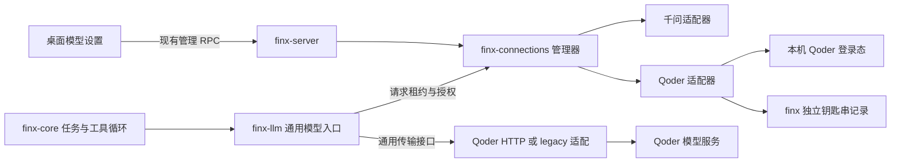
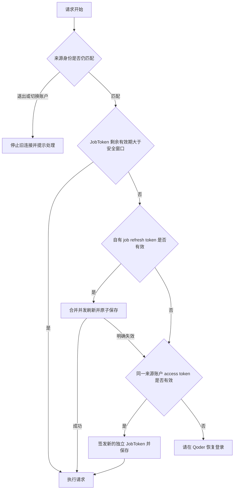

# Qoder 模型连接机制设计

日期：2026-10-29。状态：实施中；A/B 首版已落地。代码基线：`c73aa8f`。本方案延续已落地的 [内核内模型连接架构](model-connections-design.md)，已实现范围以代码为准，其余接口仍属于后续设计。

用户在模型设置中选择 Qoder，连接本机已登录账户。finx 签发并保存自己的 JobToken，之后在请求前自动续期或重新签发。第三方适配逻辑统一位于 Rust `finx-connections`，复用现有内核进程、管理 RPC 和模型调用入口，不增加 Node 网关、常驻辅助进程或本地代理端口。

连接与模型分开管理：连接成功代表身份与授权已建立；每个模型是否可以用于对话、工具任务或实验性调用，由单独的能力记录决定。首次开放优先覆盖 Auto；MiniMax 与 legacy 模型有明确的发布门槛。

## 1 事实与设计边界

依据：对本机已登录账户的实际授权验证，以及 legacy 和排队的补充验证。

| 已观察的事实 | 设计决定 |
|---|---|
| 本机 Qoder 0.4.11 全球版可读取账户登录态并签发独立 JobToken | 首期支持此产品变体与 macOS；不混用 Qoder CN、IDE 或 CLI 凭据 |
| JobToken 实测 24 小时、job refresh token 48 小时，刷新轮换两个 token | 使用实际到期字段，不把 TTL 写死；保存整个刷新结果 |
| 刷新 A 后，A 新 token、B 旧 token 和来源 account access token 仍有效 | 默认独立签发、独立存储、独立刷新，不接管来源 refresh token |
| Auto HTTP 的文本、system、函数调用及工具结果已实测 | 作为首批接入候选，仍需在 finx 内完成端到端验收 |
| mmodel HTTP 可生成，但 SSE 有异常续行、null 事件、无 DONE；目录名称与内部标签不同 | 独立兼容适配，默认不作为稳定可用模型发布 |
| qfmodel、dfmodel 的 legacy 排队各执行 4 分钟仍无答案 | 实现完整状态机，但目录发现与排队成功不算推理验收通过 |
| 原客户端在独立续期前后都持续资源排队 | 不宣称完全无影响；原客户端成功对话列为发布验收项 |

跨自然 TTL、长时间离线恢复和服务端撤销行为仍需测试。“自动续期”不等于永久免登录，也不保证任意时刻都有模型资源。

## 2 用户连接流程

本机应用区展示千问办公和 Qoder 的横向 logo 与名称。选择 Qoder 后，沿用简洁表单风格，只显示检测结果、必要状态和操作按钮，不要求填写 API Key、Base URL、clientId 或 token。

| 当前情况 | 页面呈现 | 主要操作 |
|---|---|---|
| 已检测到应用，登录态尚未核实 | Qoder、版本、“使用本机登录账户” | 连接 |
| 应用未安装 | 未检测到 Qoder | 重新检测 |
| 没有登录态或登录已失效 | 请先在 Qoder 登录 | 打开 Qoder、重新检测 |
| 系统不允许读取钥匙串 | 需要系统授权 | 重试授权 |
| 授权和目录就绪 | 已连接、可用模型数量 | 管理模型、断开 |
| 目录可读但没有通过兼容验证的模型 | 已连接，暂无可用模型 | 查看模型状态、刷新模型 |
| 个别模型排队或暂不可用 | 连接仍显示已连接 | 当前对话显示等待和取消 |

首次“连接”旁保留一句必要说明：“使用 Qoder 的本机登录状态建立独立模型授权，调用计入同一账户用量。”系统钥匙串提示由用户在操作系统中处理，finx 不收集系统密码。点击连接即开始处理，不再增加重复的应用内确认弹窗。

连接完成后回到已接入列表；默认展开可用模型，其余模型放在“其他模型”中显示原因。用户可启用、停用通过门槛的模型。实验性模型只能在兼容配置允许时显式启用，不能通过开关跳过缺失的协议解析或工具安全验收。

重启后恢复连接和稳定模型 ID，不要求重新配置。默认模型属于现有任务/会话设置；连接 Qoder 不自动替换用户的全局默认模型。移除连接保留历史任务中的引用，后续调用提示连接已移除。

## 3 模块和运行方式



| 层 | 责任 |
|---|---|
| Renderer | 多应用列表、连接状态、模型开关和等待提示，不接触秘密 |
| Electron 主进程 | 原有内核监管和按已知 bundle ID 打开来源应用 |
| finx-server | RPC 装配、能力协商与状态通知，不包含 Qoder 地址和刷新算法 |
| finx-connections 公共层 | 适配器注册、连接记录、身份绑定、秘密存储、请求租约、生命周期和单次刷新协调 |
| finx-connections Qoder 模块 | 来源登录读取、JobToken、目录、路由、COSY、legacy 编解码、特有流解析及排队清理 |
| finx-llm | 通用消息、传输接口、流事件、取消、重试契约；不含 Qoder 判断分支 |
| finx-core | system、上下文、工具执行、审批；仅提供通用会话/轮次标识和结束通知 |

当前公共管理器仍写死 `Mutex<QwenWork>`、千问名称、单一 discovery 和固定 base URL；桌面也只取 `connections[0]`、`discoveries[0]`。应先抽象这些位置，再添加 Qoder，不能复制一份独立连接管理器。

建议目录：

```text
crates/finx-connections/src/
  manager.rs                  # 通用连接与模型发布
  adapter.rs                  # 产品适配接口及注册表
  platform/                   # 系统凭据库、安装检测、受限来源读取
  qwenwork/                   # 迁移现有实现，保持其换发行为
  qoder/
    mod.rs                    # 适配入口与兼容配置
    source.rs                 # macOS 来源凭据
    auth.rs                   # 独立 JobToken 生命周期
    catalog.rs                # 模型目录与能力映射
    transport.rs              # 实现通用 WireApi 接口
    http.rs                   # 新版 HTTP 及必要流兼容
    legacy.rs                 # legacy 请求和响应转换
    cosy.rs                   # 签名与版本化编码
    queue.rs                  # 排队和 ask/finish
```

这些是同一二进制中的模块，不是服务进程。没有启用连接时，不访问凭据库和网络，不创建定时续期任务。发现操作只在设置页或手动扫描时执行。关闭桌面不结束已有内核任务；内核原有空闲退出策略保持有效。适配器更新仍需发布 Rust 二进制，模块隔离不等于独立热更新。

## 4 适配接口与请求执行

以下接口为拟新增契约，名称可在实施时按现有风格调整，语义必须保持。

### 4.1 公共产品适配接口

将应用发现和连接实例分开：`AdapterFactory` 提供产品描述、发现、来源核实和实例创建；每个 `ProductAdapter` 管理一条已经绑定身份的连接。

```rust
// 设计草图；错误、密钥和目录类型在实施时定义。
#[async_trait::async_trait]
trait AdapterFactory: Send + Sync {
    fn descriptor(&self) -> AdapterDescriptor;
    async fn discover(&self) -> Result<Vec<Discovery>>;
    async fn inspect_source(&self, discovery: &Discovery, mode: ReadMode)
        -> Result<SourceLogin>;
    fn create(&self, binding: Binding) -> Box<dyn ProductAdapter>;
}

#[async_trait::async_trait]
trait ProductAdapter: Send + Sync {
    async fn catalog(&self, http: &Client) -> Result<CatalogSnapshot>;
    async fn prepare(&self, model: &ModelRoute, reason: AuthReason)
        -> Result<Authorization>;
    fn classify_failure(&self, error: &LlmError) -> ConnectionImpact;
    async fn finish_invocation(&self, scope: &InvocationContext, outcome: Outcome);
}
```

`ReadMode` 区分用户发起的交互读取与后台无交互读取；`AuthReason` 区分普通请求和已确认的认证拒绝。`ConnectionImpact` 区分不改变连接、临时不可用、需要登录、权限不足和身份改变。锁只保护凭据更新，不能在等待模型排队的几分钟内持有全局管理锁或授权互斥锁。

### 4.2 请求级传输扩展

当前 `Authorization` 只返回 `base_url + Credentials`，足以覆盖千问的标准 HTTP 通路；Qoder 的 legacy 编码和异常 SSE 需要额外传输适配。复用现有 `WireApi` 接口，在授权结果中增加一个可选的请求级传输实现：

```rust
pub struct Authorization {
    pub base_url: String,
    pub credentials: Credentials,
    pub transport: Option<Arc<dyn WireApi>>, // 新增，默认 None
}
```

千问返回 None，继续使用现有 openai-chat。Qoder 返回定义在 `finx-connections` 的传输对象，捕获这次请求的不可变路由、目录配置、身份 generation 和私有授权快照。它直接返回 `LlmStream`，无需先转换成一条本地 HTTP 流再解析。授权对象与私有快照均不得实现会输出秘密的 Debug/Serialize。

`finx-llm` 只需要选择这个可选实现。基础 wire API 的解析应在取得当前模型快照后进行，避免模型路由更新后仍用旧 API。Qoder 模型继续采用 OpenAI 语义的通用 Context；实际业务包装由产品传输完成。

完整请求流程为：取得租约 → 核实身份 → 取得一致授权和路由 → 调用传输 → 发送通用流事件 → 清理资源 → 释放租约。每连接首期只允许一个活跃推理请求；等待本地租约和远端排队都可取消。

### 4.3 通用轮次标识与结束钩子

现有 RequestOptions 只有 cache_key，不能准确表示一次用户轮次的多次工具调用。拟增加 `InvocationContext { conversation_id, turn_id, call_id, purpose }`：会话内稳定 conversation_id，一次用户轮次稳定 turn_id，每次模型调用有不同 call_id。压缩、标题生成、子代理等使用各自作用域，避免占用主轮次的 request_set_id。

任务层通过模型注册器创建通用轮次 guard，正常结束、错误和取消时通知注册器，后者调用适配器结束钩子。任务层不直接引用 Qoder。未提供作用域的旧调用者由注册器分配单次调用作用域，牺牲跨工具调用复用但避免错误共享。

Qoder 将这些 ID 映射为不泄露本地路径和内容的远端 UUID，映射表按身份 generation 隔离。一轮内按模型分别记录远端任务；切换模型不会把旧模型的 request_set_id 发给新模型。后续重试仍归属同一任务。

## 5 首次连接与持久化

连接事务分为以下阶段；管理 RPC 不等待一次可能耗时 4 分钟的模型生成。

1. 根据 discovery_id 重新检测应用、版本、渠道和来源路径，拒绝使用过期扫描结果或 Renderer 提交的任意路径。
2. 读取并解密来源登录，核实账户 ID 与产品变体。来源 refresh token 不复制到 finx 记录，也不交给适配器刷新器。
3. 在非秘密配置中创建 connecting 记录与幂等键。首次连接失败保留可重试的本地记录，不生成重复连接。
4. 使用来源 account access token 请求独立 `/api/v1/me/jobToken`。首期使用已验证全球版 clientId，由版本化配置提供。
5. 将返回的 JobToken、job refresh token、两个到期时间及 generation 一次性写入 finx 的独立钥匙串记录。落盘失败不得报告授权已持久化就绪。
6. 读取账户目录，合并本地已验证的能力与用户模型开关，发布通过门槛的模型。
7. 发出状态通知。返回“已连接”；可单独选择“测试连接”，测试成功后记录最近验证时间。

不在连接动作中批量调用 15 个模型，也不自动签到或领取额度。目录与授权检查不保证下一次推理不会排队。

首期来源配置是 `/Applications/Qoder.app`、bundle ID `com.qoder.app`、`~/Library/Application Support/com.qoder.app.stable/auth.v1.dat`。钥匙串服务从受支持的产品配置核对，本次是 **Qoder App Safe Storage**。检测登录文件存在只能显示 unknown，不能声称已经登录。来源变体和格式采用明确兼容配置；新版本不因文件存在就默认兼容。

macOS 解密使用已验证的 v10 格式并限制输入大小。平台 API 优先支持无交互钥匙串查询；后台读取被拒绝时返回 permission_required，不反复弹出系统授权。不能将目前可能弹窗的 `security` 命令直接当作无交互接口。

| 存储 | 内容 |
|---|---|
| connections/config.json | schema、adapter_id、connection_id、启用状态、身份摘要、模型开关、幂等键 |
| 非秘密目录缓存 | upstream key、显示名称、目录能力、验证能力、路由版本、获取时间；不含授权头 |
| finx 系统凭据库 | 一条连接的完整 JobToken 记录、到期时间、generation、身份绑定 |
| 内存 | 短暂的来源 access token、请求授权快照、排队状态、刷新中的 promise/future |

身份键由产品变体、账户 ID、必要的组织维度生成摘要，邮箱和名称不作为唯一身份。provider ID 由 adapter_id 和身份键生成（见模型连接设计），同一账号移除后重新连接仍保持不变，模型引用随之稳定。默认一个来源身份在同一 FINX_HOME 只有一条连接；不同 FINX_HOME 各自签发独立凭据，不共享刷新链。

来源 account access token 只为签发临时读取，不持久保存；来源 account refresh token 始终不持有。机器标识仅在私有存储中保存，公共目录与诊断不输出其值。删除连接仅删除 finx 自有记录，不注销 Qoder，不撤销来源凭据。

## 6 自动续期与离线恢复

默认采用按需维护：没有请求就不为了保活刷新；下次使用时自动恢复。这与当前千问连接的资源策略一致。用户看到“一次连接，后续自动恢复授权”，不需要理解 token 周期。



初始安全窗口取 5 分钟，遇到短 TTL 时不超过其生命周期的一半；时间解析优先采用服务端绝对到期时间，再校验相对值与单位。持久化使用 UTC，等待和退避使用单调时钟。请求前确保凭据可覆盖预期排队预算和安全余量，长请求中不因本地到期计时主动重放已有输出。

| 情况 | 自动处理 |
|---|---|
| JobToken 仍有效 | 直接使用 |
| 临近到期且 refresh 有效 | 单次刷新，保存新 pair 后使用 |
| 刷新网络失败但旧 token 仍有足够有效期 | 保留旧 pair，短期退避；允许安全窗口内的请求，不清除连接 |
| 刷新明确失效，或离线超过 refresh 有效期 | 重新读取同一来源账户 access token，尝试一次独立签发 |
| 刷新结果可能已被服务端应用，但响应丢失 | 标记 refresh_uncertain，不并发重试旧 refresh；优先从来源重新签发 |
| 服务端刷新成功但钥匙串保存失败 | 保留新 pair 于受控内存并重试保存，暂停新推理；重启后走来源重新签发恢复 |
| 来源 access token 过期，但身份未变且自己的 refresh 仍有效 | 可以继续维护自己的刷新链；不能仅因来源 access token 到期就误判自己的授权失效 |
| 来源和自有授权都无法恢复 | needs_login，打开 Qoder 登录后重试 |
| 401 或明确的 token 无效业务码 | 只有未输出内容且确认属于认证失败时，最多一次重新授权重发 |
| 10605、配额不足、模型不支持、协议解析失败 | 交给对应错误处理，不刷新登录来“修复” |

明确的账户冻结、撤销或权限拒绝不通过重复签发绕过。403 不能仅凭数字判定认证失败，必须先解析业务码。

### 刷新并发和崩溃恢复

每连接设置 single-flight；竞争者复用同一个刷新结果。更新前重新检查 generation，旧结果不能覆盖新状态。一个 FINX_HOME 的凭据写入由唯一内核所有者负责，连接存储另有进程间锁；后来的进程读取新 generation，不再花费旧 refresh token。锁范围包含刷新、保存和发布，不跨越推理流。

一个刷新结果按整条钥匙串 item 写入；token、refresh token、有效期不能分多次独立保存。远端签发和本地落盘之间不能实现跨服务事务：中间崩溃可能留下未持久化的远端 token，恢复时只能重新核实来源并独立签发，不能声称 exactly-once。

### 来源变化与连接寿命

来源文件监听用于及时标记缓存过期，请求前再核对文件指纹；文件变化时重新解密身份。短暂缺失按原子替换处理，有限重读后仍缺失才判定未登录；权限拒绝单独分类。版本/来源无法核实时暂停新请求，不静默沿用未知身份。

用户退出 Qoder 或切换账户时，finx 停止旧连接的新请求，取消其在途请求，清除旧账户的自有授权。恢复同一身份可以 retry；切换到其他身份要求显式重新连接，历史连接不悄悄换人。服务器端撤销可能只能在下次调用时发现，不能保证即时感知。

## 7 模型目录和调用路由

目录由 Qoder 实时返回；采用 app 场景且检查 enable、格式与能力。保留 upstream key 作为稳定模型 ID，显示名称仅供展示。原始 model_config 是私有路由数据，不进入 Renderer，也不接受用户通过 extra_body 覆盖身份、签名、远端地址或任务 ID。

目录缓存建议 24 小时失效、按需刷新；手动刷新立即执行。目录网络失败保留上一次快照并标记 stale，但最终是否可调用仍取决于有效授权和已验证路由。服务端明确移除模型后停止新调用，历史引用保留。每次请求固定目录快照，流中不更换配置。

| 模型与路径 | 首期处理 |
|---|---|
| Auto，新版 HTTP | 完成 finx 文本与工具验收后默认启用 |
| mmodel，新版 HTTP | 流兼容测试通过后提供实验性文字调用；工具往返单独验收 |
| qfmodel、dfmodel，legacy | 在目录中可见，默认标为待验证；真实生成与清理验收通过后开放 |
| 其他目录模型 | 只登记，不把 enable=true 当作已适配，不自动批量试调用 |

模型记录至少区分 `declared_capabilities`、`verified_capabilities`、`readiness`、`enabled` 和 `route_revision`。readiness 为 supported、experimental、unverified、unsupported；工具和图片使用三态能力，不以 false 冒充“已确认不支持”。公开 UI 可简化成“可用、实验性、待验证、暂不支持”。

选择模型后的路由固定，不因资源排队悄悄换模型，也不在一次请求中盲目切换 HTTP/legacy。用户显式允许的模型 fallback 属于以后独立功能，不能用它掩盖当前模型失败。目录价格倍数不是美元单价；未知价格显示未知，不由默认零值展示“免费”。

连接可正常授权但某个模型不可用时，只更新该模型的诊断。不要因为一个模型排队就从注册器删除整个 Qoder provider。

## 8 推理适配和流处理

### 新版 HTTP

使用已验证的 `https://api2-v2.qoder.sh/model/v1/chat/completions`，Bearer 为自有 JobToken。system、messages、tools 由 finx 生成；适配器不追加 Magpie 的 Qoder Agent 提示词，不执行工具，也不将未知字段随意透传。

`max_tokens` 预算须考虑模型可能计入 reasoning；`reasoning_effort=none` 不作为成功关闭思考的证明。工具调用依据实际 tool_calls 判断，不能只看 finish_reason。首次提供工具能力前验证工具名、参数 JSON、调用 ID 和结果对应关系。

MiniMax 的异常流处理只作用于已识别的兼容配置，不修改所有 OpenAI 供应商的默认解析器：

- 增量处理 UTF-8 与 SSE 分帧；忽略明确的 null 心跳，不把其计为有效模型内容。
- 将已捕获异常流转成不含账户信息的固定测试样本，覆盖任意网络分片、转义字符、非 ASCII 和工具参数。
- 非标准续行的恢复必须限制在单事件内，最大缓冲初值 1 MiB。遇到歧义、跨事件拼接、超限或无法识别的变体，明确返回 protocol_error，不无限猜测修复。
- 工具参数不依靠宽松字符串拼接“修复”。文字恢复通过不等于工具流可以开放。
- 合法终止标记可以是 DONE，或已收到明确 finish_reason 后正常 EOF；先完成参数校验及有限的尾部 usage 收集。没有终止证据的 EOF 是 truncated_stream；length 保留为截断结果，不能记为正常 stop。
- 保留经过校验的实际 usage；不凭内部标签承诺物理模型身份。已输出内容后失败时保留部分输出，不自动重放。

### legacy

在 `api3.qoder.sh` 的已验证目录和推理路径上使用 COSY 认证、版本化编码、原始 model_config 和独立任务 ID。当前目录若有安全策略，原样保留，不以请求适配为由关闭。客户端版本与签名配置由兼容配置约束，不加载任意远端脚本，也不在生产请求时导入整份 Qoder SDK。

设备身份确有需要时，可调用已核实安装来源的 Qoder runtime-info 辅助程序；这不是常驻进程。不伪造设备身份，不把读取设备身份与签到、领取额度绑定。缓存按身份和版本隔离，值不进入日志。

## 9 排队和任务结束

legacy 首事件返回 10605 时，立即关闭被拒绝的 SSE，再查询 queue/status。保留 request_set_id、session_id；出队后按返回延迟等待，重发时更新 request_id 和 chat_record_id。状态里的“可请求”不是推理成功。

初始预算采用已验证插件的 4 分钟总等待、最多 10 次恢复、0.5–30 秒轮询间隔和连续 3 次状态查询失败退出。deadline 在 RequestLease 创建时固定，重新授权和更换本次传输对象也不能重置。认证恢复、网络重试和排队共用该逻辑请求的总预算，避免 4 分钟被外层重试放大成多轮长等待。

当前 StreamEvent 契约禁止适配器自行做普通重试。此次需要明确增加例外：**无模型内容时，供应商队列中的状态查询与出队重发属于协议续接**，由适配器管理。通用网络重试仍由注册器负责。

建议增加通用 `LlmError.retry_directive = default | never`；排队预算耗尽仍分类为 Overloaded，但设 never，注册器不得重开一轮预算。不是通过改成错误的异常类别来规避重试。取消也不进入自动重试。

增加通用等待进度事件，例如 `StreamEvent::Waiting { reason, retry_after_ms }`，投影为任务状态，不写入聊天内容；reason 只含 queue/backoff 等公开枚举。注册器以 `produced |= event.is_content()` 累积是否产生模型内容，不能把等待通知算作已有输出，也不能因后来的等待通知重新允许重放。该扩展需同时更新流消费端和协议能力协商。

一次轮次的全部模型/工具调用结束后发送 ask/finish，结束范围按轮次、连接、模型区分。正常完成使用显式 await，取消/drop 使用受控的清理队列；清理拥有独立的 3 秒超时，不能复用已取消的 signal。清理队列有容量上限，进程退出最多进行有限等待，崩溃时仍依赖远端 TTL，不能承诺总能释放。

暂不重复发送业务 finish 上报；它与队列释放是不同接口。结束清理失败只记录脱敏诊断，不把已完成的模型输出改成失败，也不刷新账户 token。

## 10 状态和公开接口

沿用 connecting、ready、disabled、needs_login、permission_required、unsupported、unavailable。ready 表示身份和授权路径可接受请求，不表示每个模型随时有资源。增加可选的 `last_verified_at`、`required_action`、`catalog_stale` 和 `health=ok/degraded`；refreshing 作为短暂活动信息而非登录错误。

| 错误 | 状态及行为 |
|---|---|
| job token 明确失效且自动恢复失败 | needs_login，提示来源登录 |
| 源身份切换 | needs_login + identity_changed，停止旧身份 |
| 钥匙串拒绝 | permission_required，等待用户重试 |
| 10605 或排队预算耗尽 | 连接保持 ready，当前请求等待或失败 |
| 配额不足 | 连接身份保持，模型请求失败，显示用量原因 |
| 模型不支持 | 更新该模型状态，不清空其他模型 |
| 已连接后的临时网络错误 | ready + health=degraded，保留秘密、目录和可解析路由；下次请求按退避自动重试 |
| 应用或私有协议格式不兼容 | unsupported，不盲目续期和签发 |

必须修正当前 `RequestLease::failed` 将所有 401/403 都标为 needs_login 的处理，让适配器先完成业务分类。认证重试也要求明确的 Auth 分类，而不只是状态数字。

现有 publish 只发布 ready 连接，若把临时网络错误一律置为 unavailable，会导致后续调用无法找到 provider、没有机会自动恢复。新实现以连接身份状态和健康状态分开表达：已连接后的暂时故障不移除路由；未曾建立可用目录的首次连接失败才保持 unavailable，供 retry 恢复。退避期间由 prepare 返回含 retry_after 的暂时错误，不忙循环访问远端。

现有 RPC 继续使用，以下新增部分需生成 Rust schema、TypeScript 类型并协商能力，不能把设计 DTO 直接交给旧内核：

| 接口 | 拟定行为 |
|---|---|
| connections/discover | 返回多个应用发现项，各项独立错误，不因 Qoder 缺失导致千问扫描失败 |
| connections/connect | 现有参数，adapter_id=qoder，discovery_id 为服务端签发的引用 |
| connections/list | 返回全部连接；页面按 adapter_id/connection_id 匹配，不取数组第一个 |
| connections/retry | 恢复同一绑定身份；不自动换账户 |
| connections/models | 刷新目录，不自动调用每个模型 |
| connections/set_models，新增 | 原子保存 enabled_model_ids 和 experimental_model_ids；校验兼容门槛 |
| connections/test，新增 | 显式测试一个允许的模型，返回可取消 operation_id；不让 connect 等待推理 |
| connections/operations/get 与 cancel，新增 | 读取/取消主动测试，操作受当前连接和 generation 约束；内核重启后的旧操作标记 interrupted |
| connections/disconnect | 增加可协商的 mode=drain/cancel，旧参数默认 drain；立即禁用新请求 |
| connections/remove | 只接受 disabled 且无活跃请求；删除自有秘密和配置 |
| models/changed | 目录/可用性变化时通知；不用于每次队列轮询 |
| connections/changed，新增 | 连接与主动测试状态变化；仅发送给声明支持的客户端 |

新增能力建议命名 `model_connection_details`，与既有 `model_connections` 共存；旧客户端不会收到新的等待事件或未知状态载荷。所有 operation 和请求信息均不返回 token、用户 ID、机器指纹或上游原始 headers。

## 11 原客户端隔离和安全边界

finx 与 Qoder 的凭据刷新链独立，但共用账户额度和服务端资源池。因此“不会主动修改或刷新 Qoder 的凭据”可以作为实现约束，“绝不会影响其用量、排队或长期服务端授权”不能承诺。

来源文件只读，自有秘密使用独立命名空间；当前 FINX_HOME 的删除和断开不影响其他 FINX_HOME。取消只终止自己创建的请求和任务 ID。公共 HTTP 客户端保持 TLS 校验、禁止跨来源重定向；adapter 仅允许已验证域名与路径。秘密不进入 RPC、命令行参数、普通日志、任务历史或崩溃诊断正文。

来源异常、测试失败和 token 轮换都不执行 Qoder logout、deviceToken/refresh 或服务端全账户撤销。卸载 Qoder 导致来源无法核实时按来源不可用处理；不借已有授权永久脱离用户选择的登录来源。

## 12 实施顺序和验收

| 阶段 | 交付 | 放行条件 |
|---|---|---|
| A 通用连接抽象 | 多适配器、平台读取模式、多应用 UI、请求级传输接口 | 千问全部现有回归与真实对话通过；无 Qoder 连接时无额外后台资源 |
| B Qoder 授权与 Auto | 发现、只读来源、独立 JobToken、恢复、目录、Auto 推理 | 打包桌面连接后文本、system、工具往返、取消、重启后再次对话通过 |
| C 模型协议扩展 | MiniMax 流适配、legacy、队列、轮次结束钩子 | 每个开放模型完成独立能力验收，未通过的保留待验证状态 |
| D 长期和原客户端兼容 | 生命周期测试和异常恢复 | 自然 TTL、长离线、并发刷新、原客户端前后成功对话通过 |

自动化测试覆盖：24/48 小时边界与单位、时钟偏移、休眠唤醒、并发刷新只发送一次、响应丢失、原子保存失败、重启与 generation 竞争；来源 logout/切换/暂时文件替换；独立连接状态隔离；嵌套 10605、反复出队再入队、预算不翻倍；异步取消清理、流丢弃、工具循环结束；异常 SSE 和完整工具参数；目录字段不能携带秘密或覆盖上游目标。

真实验收使用打包桌面与内核，记录账户用量和来源文件摘要。分别验证原 Qoder 与 finx 的前测成功、finx 续期后两端再次成功，并确认原账户仍可签发、旧独立 token 未被误撤销。资源排队时记录 blocked_by_resource，不能把“仍登录”或“目录成功”替代对话通过。

自然跨 TTL 的测试需实际跨越有效期；模拟时钟只验证代码分支。停用全部连接后检查没有续期任务和额外常驻进程。验收报告按模型、transport、能力、客户端版本保存证据，不写“全部模型可用”这样的整体推断。

实施先完成 B 的可用闭环，再按验收结果逐步开放 C。默认用户体验保持一次连接、自动维护授权；长期恢复需要用户登录时，给出一次明确操作，不循环弹窗、不悄悄切换模型。
