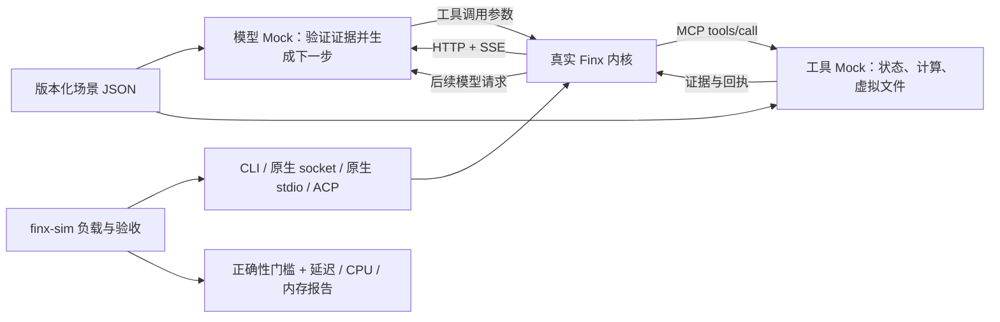

# 内核场景仿真与性能回归

版本：1 · 2026-11-03

这套体系把模型响应、工具证据和协议驱动作为可版本化的测试资产。运行的始终是真实 `finx` 内核；模型侧通过 OpenAI Chat Completions SSE，工具侧通过 MCP Streamable HTTP 接入。测试不需要模型密钥，也不请求真实金融数据。

## 分层与边界



- `crates/finx-mock/scenarios/*.json`：场景版本、任务说明、阶段计划、工具参数模板、预期观察和最终结论。资料中的企业、数字、`fixture://` 来源均为合成数据。
- `finx_mock::simulation`：模型状态机、变量绑定、工具服务、独立计算、回执与最终审计。
- `finx-mock --simulation`：可以独立启动的模型网关与配套工具服务，打印两部分配置。
- `finx-sim`：黑盒运行真实二进制，提供四个协议适配器、并发控制、超时、审计、采样和回归门槛。
- `finx-cli/tests/simulation.rs`：真实 CLI → 模型 SSE → MCP → 内核续推 → 完成/失败的集成测试。
- 原有 `finx-load` 保留，继续覆盖取消、fanout、慢消费者、大输出、长工具链和大量历史会话启动等压力场景。

原生开放接口当前是 JSON-RPC over Unix socket / stdio；没有为测试虚构一个内核不支持的 HTTP agent API。ACP 使用独立 `finx acp` 进程。驱动在 prompt RPC 返回后，通过通知队列屏障排空返回前已收到的流式更新，再验收最终文本，避免高并发时响应与通知分发的竞态。CLI 长对话通过 `exec` 后逐轮 `resume --prompt` 读取同一个会话日志，因此它测量的同时包括进程重启和恢复成本。

## 已有场景

| ID | 用户轮次 | 每轮模型阶段 / 工具调用 | 内容与独立验收 |
|---|---:|---:|---|
| `macro` | 1 | 8 / 10 | 统计来源检索，三路并行取数，口径处理，实际利率，政策情景，加权计算，来源审查和报告；加权政策变化 -26.25bp |
| `company` | 1 | 9 / 11 | 年报、分部、可比公司，增长率，经常性收入，EV → 股权价值 → 每股价值，敏感性与风险；中枢 42、区间 32.4–51.6 |
| `financial` | 1 | 9 / 12 | 三表并行取数，资产负债与现金流勾稽，现金利润比、流动比率、利息保障、压力测试；FCF 80、压力 FCF 26 |
| `coding` | 1 | 6 / 7 | 读取问题和源文件，真实产生预期失败的模拟测试，按旧版本打补丁，4 类边界回归，差异审查，存档 |
| `long-horizon` | **220** | 3 / 3 | 每轮读取上一轮已提交余额，核对交易，提交检查点；220 个用户任务、880 次常规模型请求、660 次工具调用，最终余额 **24310** |

“模型阶段”指含工具调用的 assistant 回复；每个用户任务另有一次最终回复，压缩摘要也会增加模型请求数。`--turns N` 只截短长场景用于冒烟测试；报告会明确记下截短参数，不计作完整 220 轮验收。

金融数值运算、三表勾稽、现金流压力及估值桥接由工具实现重新计算，并与资产中的 oracle 比较。编程工具维护虚拟源代码，测试根据当前补丁状态计算分页案例结果；它不是执行任意源码的沙箱。资料检索、宏观情景与评审意见是录制的合成响应。`artifact_write` 的虚拟产物保存在工具服务审计中，写入最终 JSON 报告。

这些资产验证内核编排和协议正确性，不评估真实模型的金融研究能力、推理质量或代码生成水平。

## 状态与证据契约

入口提示格式：

```text
[[mock:sim:macro:run-001:0]] 开始宏观研究
```

每个真实 MCP 调用携带：

```json
{
  "scenario": "macro",
  "run": "run-001",
  "turn": 0,
  "step": 2,
  "call": 0,
  "input": {"operation": "difference", "a": 2.8, "b": 3.6}
}
```

场景中的 `{"$ref":"1/0/headline/2"}` 表示第 1 阶段第 0 个工具观察的 `/headline/2`。模型端从已经核验的实际工具返回值解析引用；缺失或错误证据不会被默认值替代。

模型端校验全部预期调用的名称、完整参数、唯一调用 ID、匹配的工具结果及带 SHA-256 摘要的回执。并行结果可乱序到达，按调用 ID 关联；漏结果、重复 ID、错参、串会话、伪造成功、损坏检查点均失败，返回 HTTP 400，使真实任务失败。回执是确定性一致性校验，**不是对抗性认证或数字签名**。

工具端另行维护 `(scenario, run)` 状态，检查跨轮和跨阶段顺序；同一并行批次可乱序执行，当前或紧邻已完成批次的重复调用幂等，不重复写入。不同 run 的账本、虚拟源码和产物隔离。完成后驱动显式调用 `finish`，检查轮数、调用数、产物及余额，并释放状态。独立服务最多保留 100000 个 run；长期运行者应在批次结束后重启服务或通过库 API 释放审计。

上下文压缩是完整链路的一部分。Mock 接受内核追加在最后一个工具结果或用户消息上的 `<handoff_request>`，先核验工具证据，再生成 `SIM_CHECKPOINT`。检查点只保留当前任务已经验证的阶段；恢复时重新比对资产，继续未完成阶段。长对话默认可以保留大上下文，`--context-window 16000` 专门强制多次压缩。

每条 `Thinking` 是资产中人工写出的**模拟计划说明**，不来自真实模型的隐藏推理。

## 运行

在仓库根目录，Rust 工具链已进入 PATH：

```bash
cargo build --release -p finx-cli -p finx-mock -p finx-bench

# 列出资产（JSON，含内容摘要）
target/release/finx-mock --list-scenarios

# 独立运行模型和工具服务；将输出的 models.toml/config.toml 分别写入测试 FINX_HOME
target/release/finx-mock --simulation

# 也可以独立运行工具服务，stdio 或 HTTP
# target/release/finx-mcp-server --simulation
# target/release/finx-mcp-server --simulation --http 127.0.0.1:0

# 四个协议、全部场景、每场景两个会话；长对话保持完整 220 轮并强制压缩
target/release/finx-sim --protocol all --scenario suite --sessions 2 \
  --context-window 16000 --json target/simulation-results/verify.json

# 200 并发，每波创建/运行/关闭 200 个宏观研究会话，重复三波
target/release/finx-sim --protocol native --scenario macro \
  --sessions 200 --concurrency 200 --repeats 3 \
  --json target/simulation-results/load.json

# 每个会话一条连接，相当于多个客户端；默认所有会话共用一条连接，相当于一个窗口里的多个会话
target/release/finx-sim --protocol native --scenario macro \
  --sessions 200 --concurrency 200 --repeats 3 --connection-per-session \
  --json target/simulation-results/load-per-session.json

# 模拟模型与工具服务的等待时间
target/release/finx-sim --scenario company --sessions 100 --concurrency 100 \
  --ttft-ms 100 --chunk-ms 1 --tool-ms 10 \
  --json target/simulation-results/latency.json

# 故意损坏一个真实工具返回值：此命令必须非零退出并写出失败报告
target/release/finx-sim --scenario macro --corrupt-evidence \
  --json target/simulation-results/negative.json
```

一键验证：`tools/kernel-simulation.sh verify`；标准压力波次：`tools/kernel-simulation.sh load`。`CARGO_TARGET_DIR` 可以指向独立构建目录。

启动专项：`tools/kernel-simulation.sh protocol-startup` 测 ACP / Unix socket 新进程经过初始化、建会话到首个真实模型请求；`startup` 测 CLI 首请求；`cli-startup` 测本地命令墙钟。三种口径独立报告，数据与复测说明见 [启动专项报告](benchmarks/1103-kernel-performance-report.md)。

Mock MCP 配置使用 `required = true`：场景必须等工具就绪才开始。普通可选 MCP 的启动等待预算在 200 个进程同时启动时可能耗尽，不能把缺失的测试依赖混入模型阶段。

每个协议使用私有 HOME、FINX_HOME 和工作目录，清除模型密钥相关环境变量，模型目录请求也指向本地 Mock。结束时关闭内核进程和 Mock 监听器，清理临时目录；`--keep` 保留日志用于排障。默认任务/RPC 截止时间 180 秒，不会把超时算作成功。

## 指标与门槛

| 指标 | 定义 / 解释 |
|---|---|
| 正确性 | 用户任务完成、最终结构化结论精确匹配、工具事件数量、预期工具失败数量、工具服务独立审计；native/CLI 事件 seq 严格递增 |
| `startup_ms` | 服务进程 spawn → JSON-RPC initialize 成功；CLI 用 `cli_process_ready_ms` 分布测 spawn → session_started |
| `session_new_ms` | RPC 发起 session/new → 返回会话 ID；p50/p95/p99/max。共用一条连接时，回复排在其他会话的流式事件之后，满载时主要反映这段排队；`--connection-per-session` 下才是服务端处理本身 |
| `first_delta_ms` | 提交 prompt → 首个文本或模拟计划增量；包含设定的模型延迟 |
| `task_ms` | 提交 prompt → 正常任务结束；CLI 含启动、恢复与退出 |
| `turns_per_second` | 完成的用户任务数 / 各波次实际运行总秒数；排除 `--settle-ms` 静置时间 |
| CPU | 10ms 采样的内核进程 user+system CPU；CLI 短进程退出前的最后一小段可能漏采 |
| 峰值内存 | 每个采样时刻对所有存活目标进程求和，再取峰值；不是把各进程不同时刻峰值相加 |
| `rss_mib` / `footprint_mib` | 分别是 RSS 与 macOS 物理 footprint；Linux 的 footprint 用 RSS，不能跨 OS 直接比较 |
| 关闭后内存 | 每波关闭所有会话并静置默认 3500ms 后采样，覆盖 3 秒 blocking worker 回收；HTTP 连接池仍可能保留空闲连接 |
| 驱动开销 | 单独记录 driver 的 RSS/CPU，模型请求总字节数、最大请求体和 Mock 规划墙钟时间，避免误把生成器瓶颈归因于内核 |
| 压缩计数 | native/stdio/CLI 记录 compaction_completed；ACP 不公开同名事件，当前计数为 0，不能据此判断未压缩，完整模型请求数另行记录 |
| 资源 | 线程、真实打开 FD 数；Linux CPU ticks 使用系统 `_SC_CLK_TCK`，不假定 100Hz |

任何用户任务失败、模型契约错误、工具契约错误、审计不一致或没有有效内存采样，都会令进程非零退出。编程场景中预期的一次测试失败不算负载失败，但必须在协议事件中被正确报告。

可设置 `--max-peak-mib`、`--max-task-p95-ms` 作本机绝对预算。对照运行：

```bash
# 基准、候选必须由同一份 finx-sim 驱动，参数及场景摘要一致
# 先在优化前保存一个 release 内核二进制，例如 target/release/finx-before
target/release/finx-sim --finx target/release/finx-before \
  --scenario macro --sessions 200 --concurrency 200 --repeats 3 \
  --json target/simulation-results/before.json

target/release/finx-sim --finx target/release/finx \
  --scenario macro --sessions 200 --concurrency 200 --repeats 3 \
  --compare target/simulation-results/before.json --max-regression-pct 20 \
  --json target/simulation-results/after.json
```

对照校验会拒绝失败基准、协议/场景/参数/OS/架构不匹配或驱动二进制不一致。报告保存目标与驱动的 SHA-256。默认比较进程启动、任务 p95、session/new p95、峰值 footprint；20% 是回归报警阈值，不是性能目标。

首次执行新编译或新复制的 macOS 可执行文件可能包括操作系统校验成本。比较内核成本时，两份目标先各运行一次 `--version`，再交错重复至少三组；保留首次冷执行数据，不能把一次暖缓存结果包装成冷启动改进。测试机器、供电、后台负载、协议、并发数、延迟设置、窗口与驱动必须一致。默认短延迟模式适合找内核瓶颈，带延迟模式适合观察大量等待中的会话。

## 本轮修复与优化

1. 修复 `compaction_completed` 的序号字段冲突：顶层 `seq` 保持事件流水号，压缩次数改为 `compaction_seq`；同步 JSON Schema、TypeScript 生成类型、示例及回归测试。
2. OpenAI Chat 请求直接从已有工具定义序列化 Schema，去掉每次请求构造第二棵 JSON 树的深拷贝。保留 strict 参数和 extra_body 覆盖语义，并用请求快照及嵌套 Schema/覆盖测试验证。没有修改 Context 的公开类型。
3. 新会话日志在 `Settle` 前只保留内存条目，直接在异步任务处理，避免无 I/O 的 blocking-pool 往返；实际写盘和 sync 仍在 blocking pool，日志命令批次的向量容量复用。
4. 服务器记录已关闭会话计数，让小于 2 秒的 create/run/close 波次也触发下次静置内存回收，避免仅轮询 busy 状态漏掉整个突发。
5. 共享 HTTP 客户端每个 host 最多保留 32 个空闲连接，限制突发结束后连接和缓冲区的滞留；活动请求并发不受此值限制，空闲过期时间仍为 30 秒。
   2026-11-03 已撤销：200 并发时超出上限的连接一放回池里就被关掉，下一次请求只能重新建连，这正是 [1103 报告](benchmarks/1103-kernel-performance-report.md)中任务 p95 回退的主因（technical-design §1.4、D-96）。

这些修改均由相同场景和独立二进制对照检验。测量结果见同目录 `benchmarks/` 中的本轮报告；原始详细报告在工作区 `target/simulation-results/`。

## 扩展资产

新增 JSON 遵守 `Scenario/Stage/FixtureCall` 的 `deny_unknown_fields` 结构，递增资产版本，给每阶段命名并写明依赖的观察；将文件注册到 `scenarios()` 及摘要清单。优先给输入使用 `$ref`，避免把已读取数字又手写一次。新增计算工具时，在 `compute` 实现独立操作，再写预期 oracle；新增文档资料可以使用录制响应。

单元测试会遍历全部注册资产，重算金融数据、修复虚拟代码并完整执行 220 轮。应同时增加破坏契约的测试，以及在 `finx-sim` 中跑所有支持协议。性能修改必须先通过正确性门槛，再看延迟和内存；比较工作负载不一致时不得下结论。
